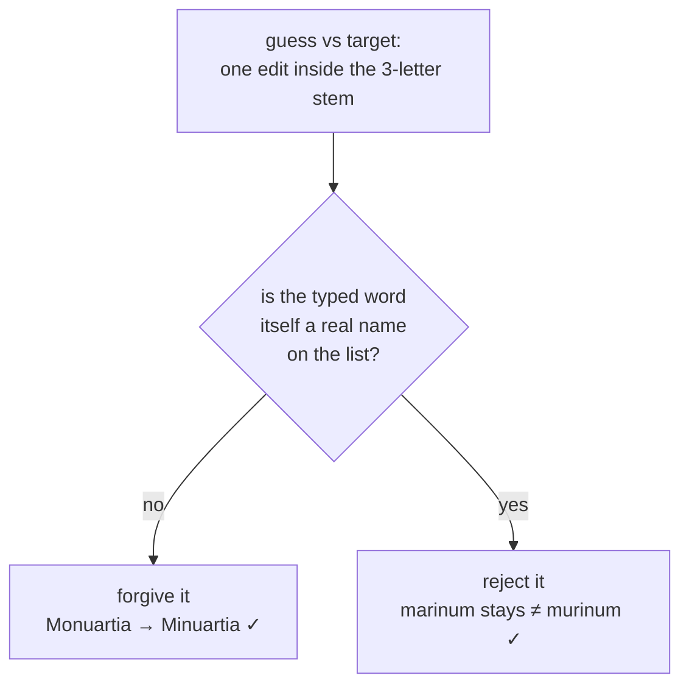

# Retrospective — the day every correct answer scored 0/2

**Date:** 2026-08-04 · **Scope:** `public/app.js`, `data/taxa.json`, `test/scoring.test.js`, `scripts/check.sh`
**Trigger:** three screenshots, all showing a correct determination graded `0/2 points`.

This is a lessons-learned writeup, not a changelog. It records *why* the bugs
happened, *how* we found them, and the tradeoffs behind each fix — the reasoning
that a diff throws away.

---

## TL;DR

| # | Symptom | Root cause | Fix | Class |
|---|---------|-----------|-----|-------|
| 1 | Every checked answer → `0/2`, even verbatim-correct ones. "Enter skips the question." | `$('#check').onclick = doCheck` — `onclick` passes a `MouseEvent`, which landed in `doCheck`'s `skipped` parameter and is truthy → every answer scored as blank. | Arrow-wrap the binding **and** coerce `skipped = skipped === true`. Added a static guard (`check.sh` step 8). | Event leaked into a semantic flag |
| 2 | `Monuartia` for *Minuartia* → genus `0/1`. | The three-letter stem rule (Invariant #3) rejects **any** typo in the first three letters. | Forgive one in-stem edit, but only when the typed word isn't itself a real name on the list. | Over-strict heuristic |
| 3 | `Cenchrus setaceus` (current name) → `0/2` against listed `Pennisetum setaceum`. | Dataset held the **former** accepted name; no synonym recorded. | Audited all 500 against iNaturalist + Jepson; added 28 current-name `alts`. | Stale reference data |

The headline lesson: **one loud symptom was aliasing three independent bugs.**
Everything showed `0/2`, so #2 and #3 were invisible until #1 was fixed.

---

## Problem 1 — the bug that hid the others

### What we saw
Three cards, three `0/2`s. The most damning was `Lythrum hyssopifolia` typed
**character-for-character correct** and still marked wrong. That single data
point collapsed the hypothesis space: the matcher *cannot* be at fault, because
the test suite proves all 500 verbatim names score full and it was green.

### Root cause
```js
// public/app.js
input.onkeydown = e => { if (e.key === 'Enter') { e.preventDefault(); doCheck(); } }; // ✓ no arg
$('#check').onclick = doCheck;          // ✗ onclick calls doCheck(MouseEvent)
$('#skip').onclick  = () => doCheck(true); // ✓ arrow-wrapped
```

`doCheck(skipped)` treats a truthy `skipped` as "graded blank." A `MouseEvent`
is truthy. So **clicking** Check scored the card as skipped — `0/2` — while
**pressing Enter** (which calls `doCheck()` with no argument) worked fine. The
user was clicking.

> The inconsistency *was* the bug: line 465 arrow-wrapped, line 464 didn't.

### Why "Enter also skips" was the same bug
A mis-scored click sets `answeredCorrect = false`. The post-reveal keydown
handler then runs `grade(answeredCorrect ? 2 : 0)` → `grade(0)` → **Again**. So
after a broken click, pressing Enter to continue graded the correct card as a
lapse. Two reported symptoms, one root cause.

### Fix + hardening
```js
$('#check').onclick = () => doCheck();   // intent explicit, matches #skip
```
```js
function doCheck(skipped) {
  skipped = skipped === true;  // an event can never again masquerade as a skip
  ...
}
```
The coercion is defense-in-depth: even a future bare `onclick = doCheck` can no
longer over-credit. `check.sh` step 8 statically forbids the bare binding and
requires the coercion — guarding the **class**, not just the instance.

### Lesson
**Stop reasoning; reproduce in the real thing.** The drill flow "looked correct"
on paper for several passes. The bug only surfaced when we drove an actual
browser (Playwright) and *clicked* — because the bug lived in the difference
between "call with no arg" and "call from an event handler," which no amount of
reading reveals.

---

## Problem 2 — the matcher tradeoff that has no free lunch

### The tension
`Monuartia` → *Minuartia* is one substitution at position 2. So is
`marinum` → `murinum` — and *Hordeum marinum* and *Hordeum murinum* are **both
real species on the CNPS list**. Looking at the guess/target pair alone, nothing
distinguishes "forgivable typo" from "you named a different plant."



The only signal that separates them is **external**: `murinum` is a real
epithet; `Monuartia` is not a real genus. So the fix had to consult the whole
name set, which the matcher previously never did.

### Solution
- A `RESERVED` index (`{ genera, epithets }`) built once at boot by
  `indexNames(TAXA)` — armed with 353 genera / 361 epithets.
- `wordMatch` relaxes the stem rule for a **single** edit, but vetoes the match
  if the guess is in `RESERVED` for that slot.
- **Fail-safe:** if the index is empty (common-name path, or matcher used before
  boot), stay strict. An un-indexed matcher is *conservative*, never wrong.

### Tradeoffs
| Choice | Why | Cost |
|--------|-----|------|
| Consult the full name set | It's the only thing that distinguishes typo from real name | Matcher gained global state (an index) it didn't have |
| Veto on *any* real name, even across slots | Keeps the 500×500 collision count at exactly 0 | A rare legit typo that happens to spell another real epithet is marked wrong — acceptable, and matches how a human grader treats "you wrote a valid but different name" |
| Fail-safe to strict when un-indexed | A forgotten `indexNames()` degrades to old behavior, not to over-crediting | Silent leniency loss if boot wiring breaks — caught by the boot test |

Written TDD-first: the test asserted `Monuartia douglasii → 2/2` and **failed
red at 1/2** before the fix, proving it tested the real behavior.

---

## Problem 3 — auditing 500 taxa without inventing anything

### The trap
The tempting move — "I know botany, I'll add synonyms from memory" — is exactly
how you poison a study tool three days before an exam. Every synonym had to be
**traceable to an authority**.

### Method
1. **iNaturalist as resolver.** Query each listed name; iNat returns the *active
   accepted* name plus `matched_term` (what you asked). If the accepted binomial
   differs, the listed name is a synonym and iNat's name is the candidate `alt`.
   Throttled ~1/sec, cached, resumable. 500/500 resolved, 0 errors.
2. **Curate hard.** 57 raw candidates → **28 kept**. The rest were fuzzy-search
   garbage: genus-only `spp.` entries matched to families/orders
   (`Typha`→`Poales`), or different species (`Pinus monophylla`→`edulis`),
   or foreign-language homographs (`Briza`→`Betula` via Czech *bříza*).
3. **Jepson eFlora as tiebreaker** for the ambiguous few — it's *the* California
   authority and it corrected iNat once:

   | Taxon | iNat said | Jepson said | Decision |
   |-------|-----------|-------------|----------|
   | *Orobanche fasciculata* | *Aphyllon franciscanum* (wrong — a different species) | *Aphyllon fasciculatum* | took Jepson |
   | *Leptosiphon aureus* | *L. chrysanthus* | *L. chrysanthus* (*aureus* was an illegitimate homonym) | added |
   | *Festuca arundinacea* | *Lolium arundinaceum* | *Schedonorus arundinaceus* | added **both** |
   | *Kalmia polifolia* | *K. microphylla* | keeps *K. polifolia* | skipped |

### Tradeoffs
- **Lenient over strict.** For a learner, wrongly rejecting a valid current name
  costs more than accepting an extra synonym — *provided* it never collides. So
  we accept multiple names per taxon (e.g. *Festuca* → *Lolium* **and**
  *Schedonorus*), and lean on the 500×500 guard to prove no collision slipped in.
- **The guard replaces human diff review.** `data/taxa.json` is single-line
  (Python `json.dumps`), so `git diff` shows "the whole line changed" and is
  useless for review. The safety net is instead: (a) a merge serializer that
  round-trips the original **byte-for-byte** or aborts, and (b) the exhaustive
  collision check. Correctness is *proven*, not eyeballed.

---

## Cross-cutting lessons

1. **Symptom aliasing is dangerous.** A single generic failure (`0/2`) hid three
   unrelated causes. Fix the loudest first *specifically enough to confirm it*,
   then look again — the quiet ones surface.
2. **A verbatim-correct input scoring wrong is a gift.** It instantly rules out
   whole subsystems (here: the matcher) and points at wiring/state.
3. **Guard the class, not the instance.** Step 8 forbids *any* handler that leaks
   an event into a boolean flag, not just this one line.
4. **Fail safe, not open.** The stem relaxation degrades to strict when
   un-indexed; the data merge aborts rather than corrupt. Wrong-but-conservative
   beats wrong-and-silent.
5. **Never invent reference data.** Source it, keep it traceable, prefer the
   domain authority (Jepson for CA), and let an automated invariant validate the
   merge.
6. **The exam deadline shapes the risk calculus** — same reason the scheduler
   ladder is in minutes. Three days out, a wrongly-rejected correct answer erodes
   trust in the tool; a wrongly-accepted synonym that can't collide is cheap.

---

## Follow-ups / open questions

- `data/taxa.json` remains hand-maintained with no regeneration script (by
  design). The audit tooling lives outside the repo (scratch) — re-run it
  periodically as iNat/Jepson taxonomy drifts.
- Synonym coverage is **one-directional**: we added *current* names for taxa
  listed under *former* names. Historical synonyms for taxa already listed under
  their current name were not swept in — lower value, but a known gap.
- Consider adding *Schedonorus*/*Lolium*-style multi-authority alternates more
  broadly if learners report other "current name marked wrong" cases.
